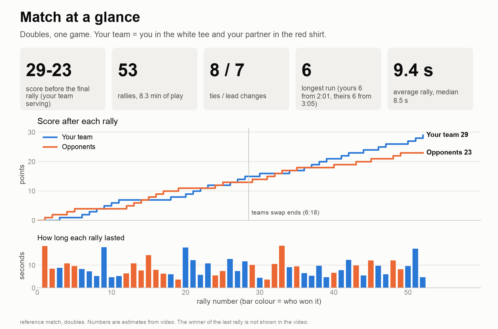
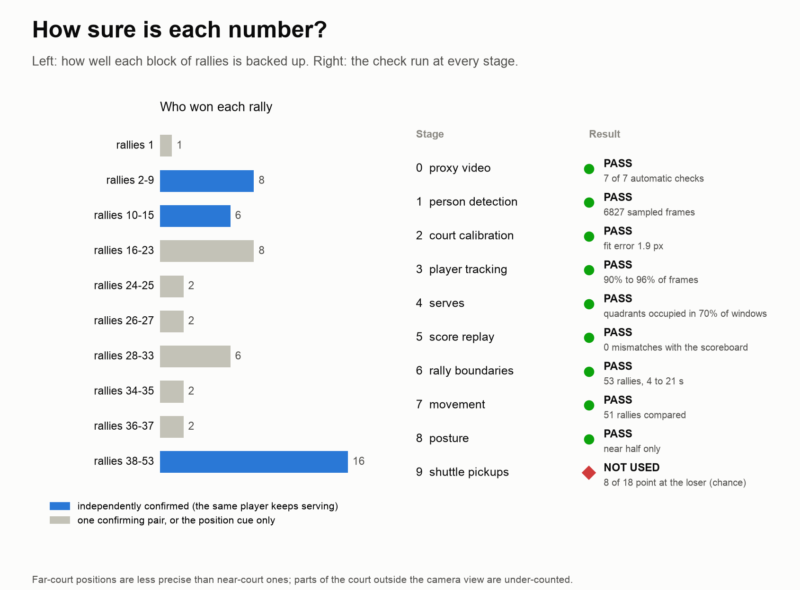

# Badminton Analysis

Turn a video of a **doubles** badminton game into numbers you can act on: where each player stood, who served,
how long the rallies were, how far you ran in rallies you won versus lost, how you hold your body, and a short
list of moments worth re-watching. It runs on your own computer, costs nothing, and is built to be driven by an
AI coding assistant ([Claude Code](https://claude.com/claude-code)) that asks you a few questions, runs the steps, and
writes the coaching notes from the numbers.

> **Status: alpha.** Built and checked end to end on **one** video (an edited game with an on-screen scoreboard).
> Everything else is untested. Read [What it cannot do yet](#what-it-cannot-do-yet) before you trust a result.



## What you get

* `report.md`: the match in numbers, with how sure each number is, and the checks that ran.
* About 11 images: score timeline, serving, rally length, you won-vs-lost, heatmaps, posture, coaching tips,
  "moments to check" with video times, and a page on how reliable each part is.
* Optionally an overlay video (player labels, score bar, top-down mini-map, a spoken summary).

See a full example, with faces blurred, in [`examples/reference-match/`](examples/reference-match/).



## Quick start

You need: a computer (tested on a Mac with Apple silicon; Linux and Windows are untested and run on the CPU),
Python 3.10 to 3.12, [ffmpeg](https://ffmpeg.org), and a video from a **fixed camera** (see the
[filming guide](docs/FILMING_GUIDE.md)).

```bash
git clone https://github.com/setuparimi/ai-badminton-analysis.git
cd ai-badminton-analysis
bash setup.sh
```

Then open [Claude Code](https://claude.com/claude-code) in that folder and type:

```
/analyze-match path/to/your/video.mp4
```

Claude reads [`CLAUDE.md`](CLAUDE.md), asks you about the players and the camera, and runs the steps. Two of them need
you: clicking a few court lines on a photo (a small page opens), and confirming where the game starts. The full,
non-technical walkthrough is in [docs/USING_WITH_CLAUDE_CODE.md](docs/USING_WITH_CLAUDE_CODE.md).
Prefer to run it yourself? See [`run_all.sh`](run_all.sh) and [docs/HOW_IT_WORKS.md](docs/HOW_IT_WORKS.md).

## What it cannot do yet

Please read this. It is the honest list.

* **Doubles only**, one fixed camera, one game. Singles, moving cameras and multi-game matches are not supported.
* **Who won each rally comes from a scoreboard.** The tested path reads the score shown on screen. Without a
  scoreboard the program tracks the players but stops before rallies and won/lost splits. A way to enter the score by
  hand is the most useful missing piece.
* **Who served is inferred** from how the players stand before each serve. It is backed by an independent check, but
  parts of the reference game rest on that cue alone (see the "how sure" image).
* **Far-court positions are rougher** than near-court ones, and anything outside the camera's view is missed.
* **No shuttle tracking**, so no shot types, smash counts or landing spots.
* **One game, about 50 rallies**: most comparisons cannot detect small effects. Treat patterns as questions to check on video.
* **Tested on one machine and one video.** Expect to adjust things on yours. Please open an issue with what broke.

## How it works, in one table

| stage | does | output |
|---|---|---|
| 0 | makes a standard 1280x720, 30 fps copy | `proxy.mp4` |
| 1 | finds every person (YOLO) | `dets.json` |
| 2 | fits the court to the picture from points you click | `calib.json` |
| 3 | follows the four players in court metres, finds the game start | `players.npz` |
| 4a to 6 | reads the scoreboard, works out who served and won, marks rallies | `points.json` |
| 7 | distance, speed, where you stood, how your pair covers the court | `motion.json` |
| 8 | body landmarks: knee bend, racket hand | `pose_stats.json` |
| 9 | looks for shuttle pickups (did not work on the reference video) | `pickups.json` |
| 10 and 12 | report and images | `report.md`, `images/` |
| 11 | overlay video with a spoken summary (optional) | `analysis_video.mp4` |

Details, file formats and how to extend it: [docs/HOW_IT_WORKS.md](docs/HOW_IT_WORKS.md).
How this project was built, what went wrong and what was learned: [docs/PROJECT_REPORT.md](docs/PROJECT_REPORT.md).

## Privacy and rights

* The analysis runs **on your computer**. Your video is never uploaded by this project.
* **If you use an AI assistant, frames it looks at are sent to that provider** as part of the chat. The assistant is
  told to ask you first. If that is a problem (for example children in the video), look at the check images yourself.
* Videos show real people. Only analyse video you filmed or have permission to use, and do not publish frames that
  show faces. `tools/anonymize.py` blurs them for examples, but no automatic blur is guaranteed: look at every image.
* No video, frame, or personal data from the reference match is included beyond blurred images and numbers. This repo does not download videos from the internet.

## Licence and credits

[AGPL-3.0](LICENSE). The person detector and pose model are [Ultralytics YOLO](https://github.com/ultralytics/ultralytics)
(AGPL-3.0); their weights download on first run and are not included here. Court geometry follows the Badminton World
Federation laws of badminton. On macOS the optional scoreboard reader uses Apple's Vision framework.

## Contributing

Issues and pull requests are welcome, especially: results on other videos, a way to enter the score by hand, a Windows/Linux
scoreboard reader, and singles support. See [CONTRIBUTING.md](CONTRIBUTING.md).
