# Badminton Analysis


Give it a video of a **singles or doubles** badminton match, click yourself in a picture, and get a **PDF report**: how the game went, a coaching plan for you
(what is working, what to work on, what to check on video), scouting notes on the opponents, the charts, and the moments worth re-watching. It runs on your own
computer and costs nothing. It asks a few questions first (which video, singles or doubles, which hand you hit with, whether the video shows a live score, when each
game starts), then two clicks: the court lines, and yourself. Your partner and the opponents are found for you.
It can also be driven by an AI coding assistant ([Claude Code](https://claude.com/claude-code)) that runs the same steps and checks the results with you.

> **Version 0.2, alpha.** Two routes. With a **live score on screen** (doubles) you get the full report, including who won each rally. **Without one**, the usual case for a
> match you filmed yourself, you get a report on positions, movement and pace of play for every game in the video. Both were run end to end on real matches; singles is
> tested on synthetic data only. Read [What it cannot do yet](#what-it-cannot-do-yet) before you trust a result.

<p align="center">
<a href="examples/reference-match/match_report.pdf">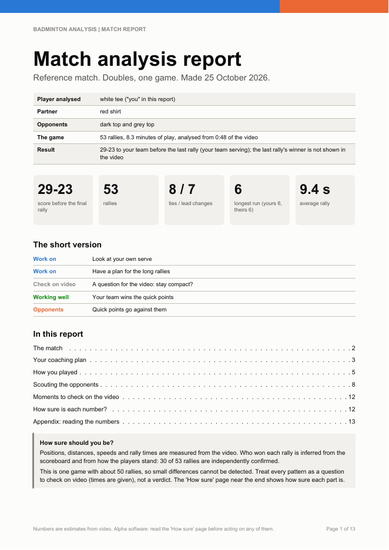</a>
<a href="examples/reference-match/match_report.pdf">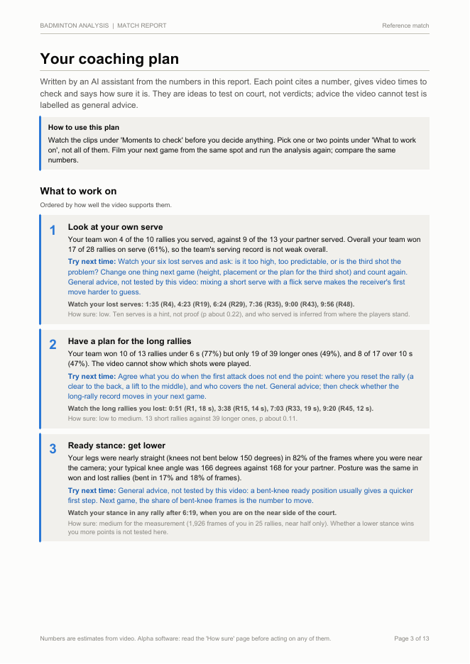</a>
<a href="examples/reference-match/match_report.pdf">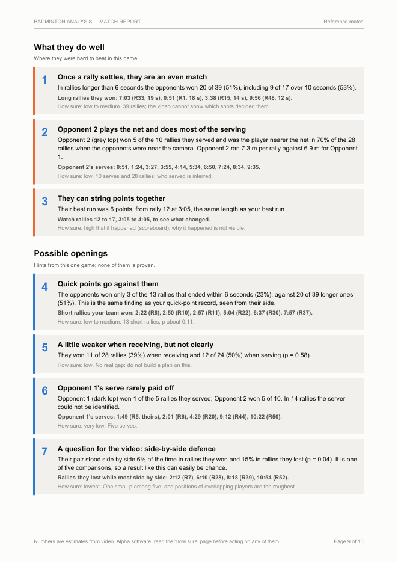</a>
</p>
<p align="center"><em>Three pages of the example for the scoreboard route (<a href="examples/reference-match/match_report.pdf">13-page PDF</a>). For the route without a score see the
<a href="examples/sample-no-score-report/match_report.pdf">sample report</a> (invented data). Charts only, no photographs of people.</em></p>

**Jump to:** [What you get](#what-you-get) · [Examples](#examples) · [Quick start](#quick-start) · [What it cannot do yet](#what-it-cannot-do-yet) · [How it works](#how-it-works) · [Privacy](#privacy-and-rights)

## What you get

* **`match_report.pdf`**: a cover with the short version, **your coaching plan**, the charts in plain words, **scouting the opponents**, moments to check with video times, and how sure each
  number is. Charts only, so it is safe to pass on.
  * *With a live score:* also serving and receiving, rally length, rallies won against lost, and the opponents' results.
  * *Without one:* the court that was analysed, where you and your partner stand (heat maps), how the pair is arranged, how hard each of you works, posture, pace of play, the opponents' habits,
    and a plain statement that it cannot know who won a rally, who served or what shots were played.
* Scoreboard route only: `report.md` (the same facts as text), 14 images and an optional overlay video with a spoken summary.

## Examples

* **Scoreboard route**: [`examples/reference-match/`](examples/reference-match/), a real game, anonymised (faces and crowd blurred; the video itself is not in this repo).
* **No-score route**: [`examples/sample-no-score-report/`](examples/sample-no-score-report/), a **sample built from invented data** (`tools/make_sample_report.py`). Nobody played that match,
  so it shows the layout without publishing anyone's real weaknesses.

Blue always means your team (or a rally you won), orange the opponents (or a rally you lost). The reference game, in pictures:

| | |
|---|---|
| 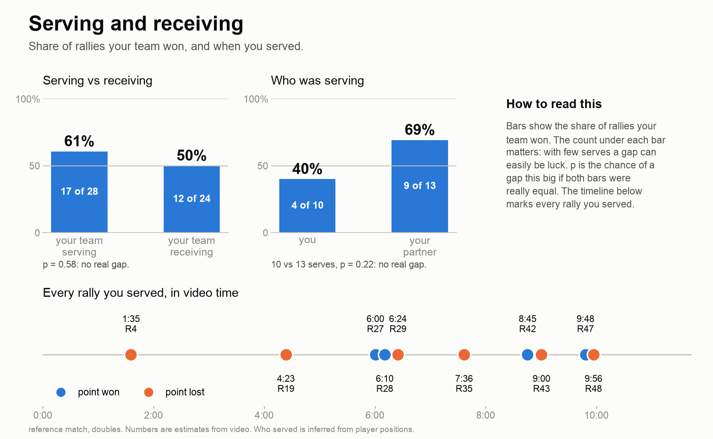 | **Serving and receiving.** Won 61% of rallies when serving, 50% when receiving (p = 0.58, no real gap); the timeline marks every rally you served. |
| 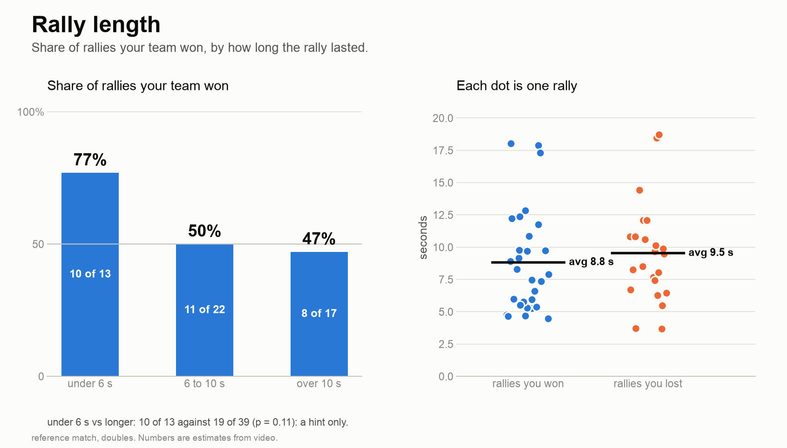 | **Rally length.** Rallies under 6 s were won 10 of 13 times, longer ones 19 of 39: a hint (p = 0.11), not proof. |
| 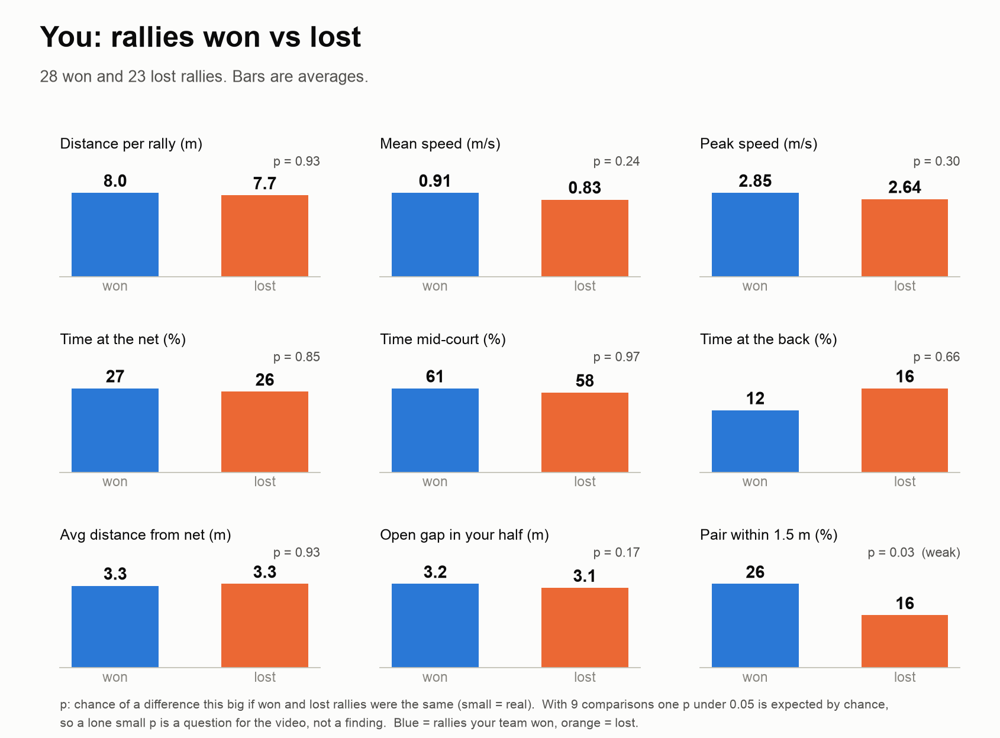 | **Won versus lost.** Nine movement measures; one small p-value (p = 0.03) among nine is expected by chance, so the page calls it a question for the video. |
| 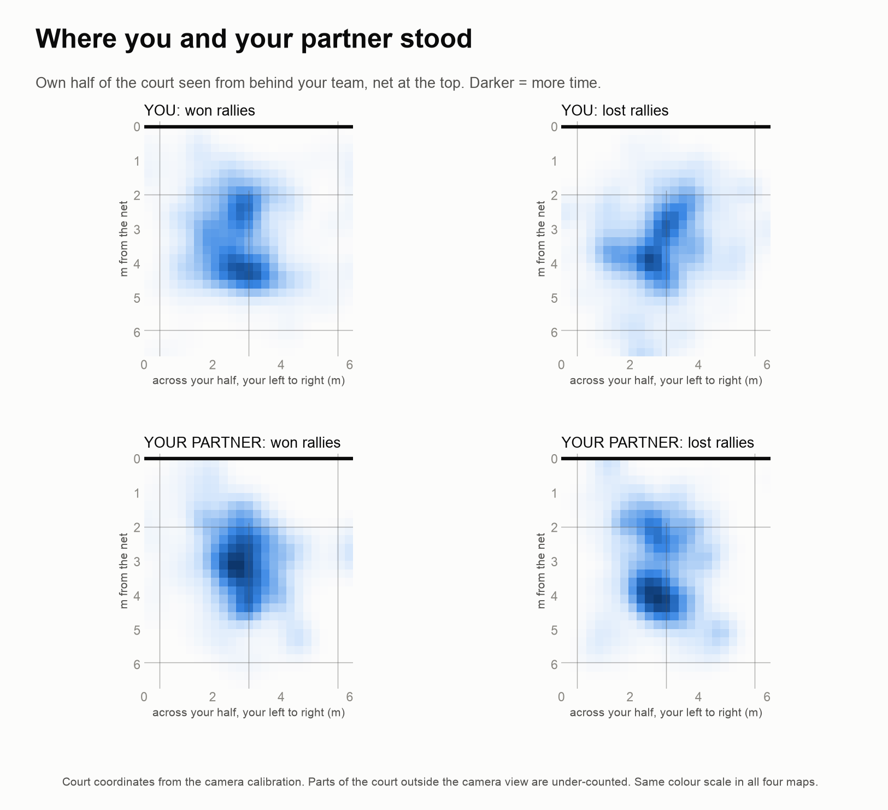 | **Where you and your partner stood**, split by won and lost rallies. Parts outside the camera view are under-counted. |
| 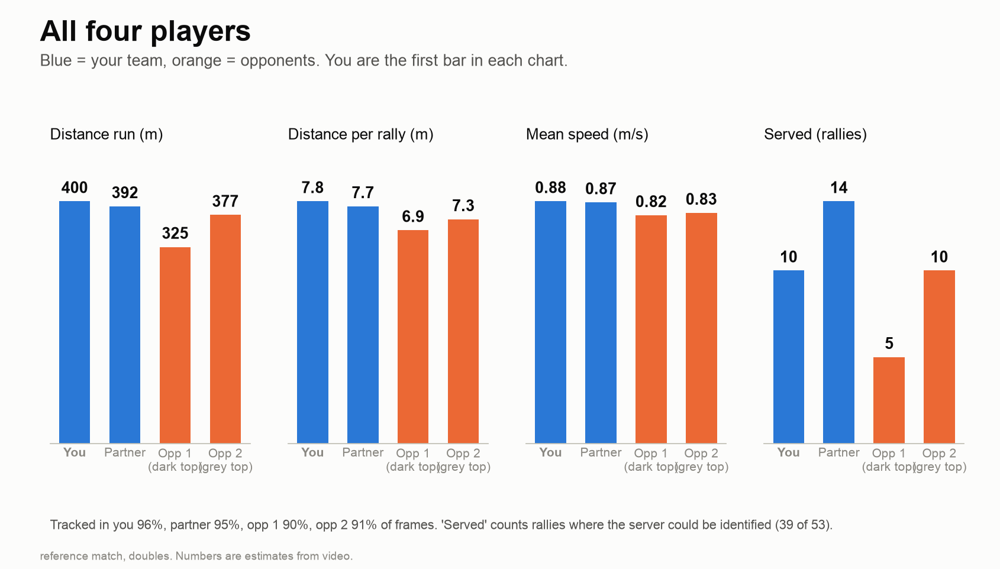 | **All four players**: distance, speed and serves, each followed in 90 to 96% of frames. |
| 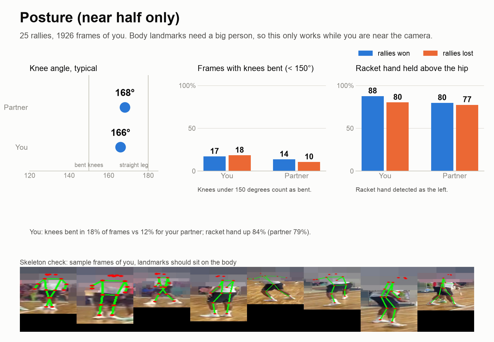 | **Posture** (near half only): knee angle and racket-hand height, with sample frames showing the body points sit on the body. |
| 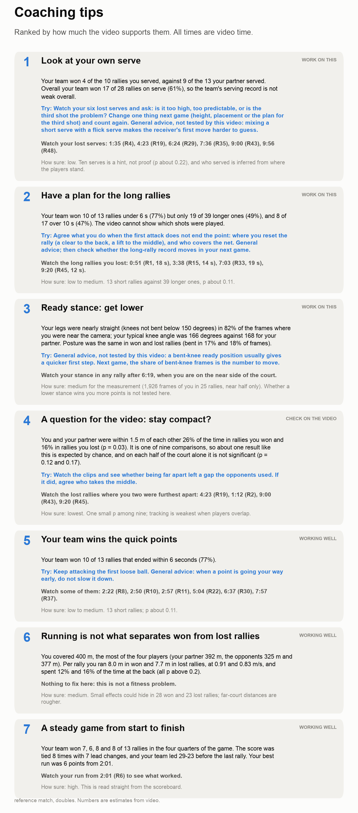 | **Coaching tips**, written by the AI assistant from the numbers, each with a next step, times to watch and how sure it is. |
| 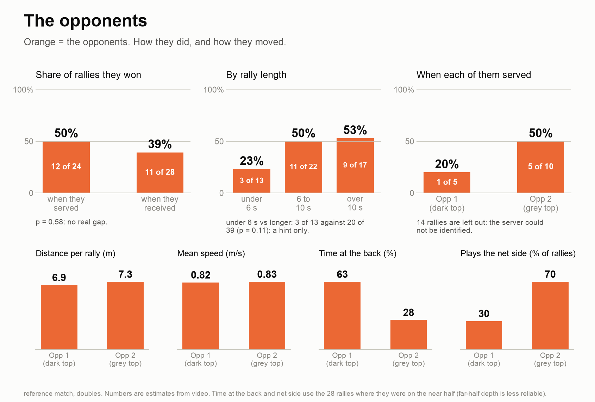 | **The opponents**: results by server and rally length, distance, speed, time at the back, who plays the net side. No shuttle tracking, so no shot types. |
| 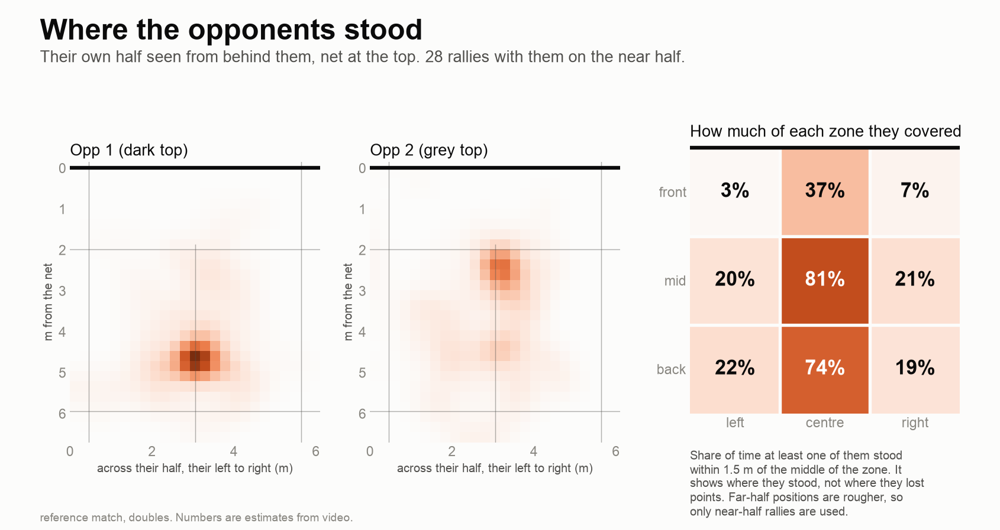 | **Where they stood** in their own half. It shows where they stood, not where they lost points. |
| 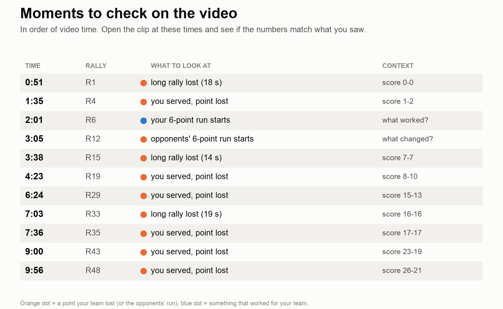 | **Moments to check**: video times with the rally, the score and what to look at. |
|  | **How sure**: blue blocks of rallies were confirmed a second way, grey rest on one cue; the right side is each stage's check. |
| 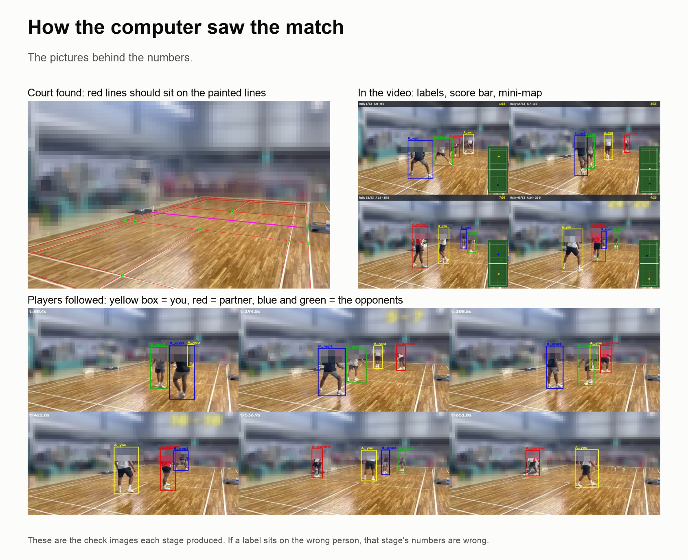 | **How the computer saw the match**: the court fit, the overlay video and the four players followed. If a label sits on the wrong person, the numbers from that stage are wrong. |

## Quick start

You need a computer (tested on a Mac with Apple silicon; Linux and Windows are untested and run on the CPU), Python 3.10 to 3.12, [ffmpeg](https://ffmpeg.org), and a video from a
**fixed camera** (see the [filming guide](docs/FILMING_GUIDE.md)).

```bash
git clone https://github.com/setuparimi/ai-badminton-analysis.git
cd ai-badminton-analysis
bash setup.sh
.venv/bin/python tools/analyze.py
```

`tools/analyze.py` asks, one at a time: where the video is (a file, or a YouTube link to a match you filmed) and what to call the match; **singles or doubles**; **which hand you hit with**; whether the
video shows a **live score** (usually no); when each game starts and ends (Enter for one game, the whole video); and each game's final score if you know it (used to check the number of plays found).
Then it makes a small copy of the video and, while it finds the people in it, opens two pages in your browser: **click where the painted court lines cross**, then **click yourself** in a few pictures of the game.
In doubles your partner (the other person on your half) and the opponents (the two on the other half) are found for you, and the page says how you can be told apart (shirt colour, shade, or light against dark shorts)
and checks that over about 12 seconds of video. After that nothing more is asked. The result is `work_<name>/match_report.pdf`. Every answer can be a flag instead (`--help`), and running it again with the same
`--work` folder carries on where it stopped.

Prefer an assistant? Open [Claude Code](https://claude.com/claude-code) in the folder and type `/analyze-match path/to/your/video.mp4` (or a YouTube link). Claude reads [`CLAUDE.md`](CLAUDE.md), asks the same questions in one message,
runs the guided run, looks at the label check sheets with you and can write the coaching words itself. A YouTube link needs the optional extra (`.venv/bin/pip install -r requirements-youtube.txt`), a yes from you that you
filmed the video or may use it, and downloads that one video only. With a live score on screen (doubles) the scoreboard route of [`run_all.sh`](run_all.sh) is used and adds one more step, confirming where the game starts.
More: [docs/USING_WITH_CLAUDE_CODE.md](docs/USING_WITH_CLAUDE_CODE.md), [docs/HOW_IT_WORKS.md](docs/HOW_IT_WORKS.md).

## What it cannot do yet

The honest list.

* **One fixed camera.** Moving cameras are not supported, and most broadcast-style matches on YouTube (cuts, close-ups, replays) do not work; a club match filmed from a tripod does.
  Several games in one video are fine; the scoreboard route handles one game at a time.
* **Without a live score it cannot know who won a rally,** who served, what shot was played or where the shuttle landed. Plays are found from movement and the sound of the shuttle (37 and 32 found against 40 and 34 on one match
  where the result card allowed a check); the sound also picks up other courts, so single plays can be merged or split.
* **Telling you from your partner** uses clothes (shirt colour, shade, or light against dark shorts). On the long matches checked, labels were wrong for short runs: in about 1 to 10% of the samples where the shorts could be read
  (and in 2 of 12 sheet moments in one game), mostly when the two of you overlap or one of you is at the camera. Opponents who look alike are tracked as a pair. The report states these numbers.
* **Singles** is supported only without a live score, and only tested on synthetic data. The scoreboard route is doubles only, and its reader needs a yellow server-first score like the reference video.
* **A wide-angle lens** (a GoPro, say) works, but the far half of the court is seen small, so far-side depth and distance are rougher; compare players on the same side.
* **No shuttle tracking**, so no shot types, smash counts or landing spots. Opponent scouting is about positions (and, with a score, results), never about shots.
* **A few games, tens of rallies each:** most comparisons cannot detect small effects. Treat patterns as questions to check on video.
* **Tested on one machine and a few videos.** Expect to adjust things on yours, and please open an issue with what broke.

## How it works

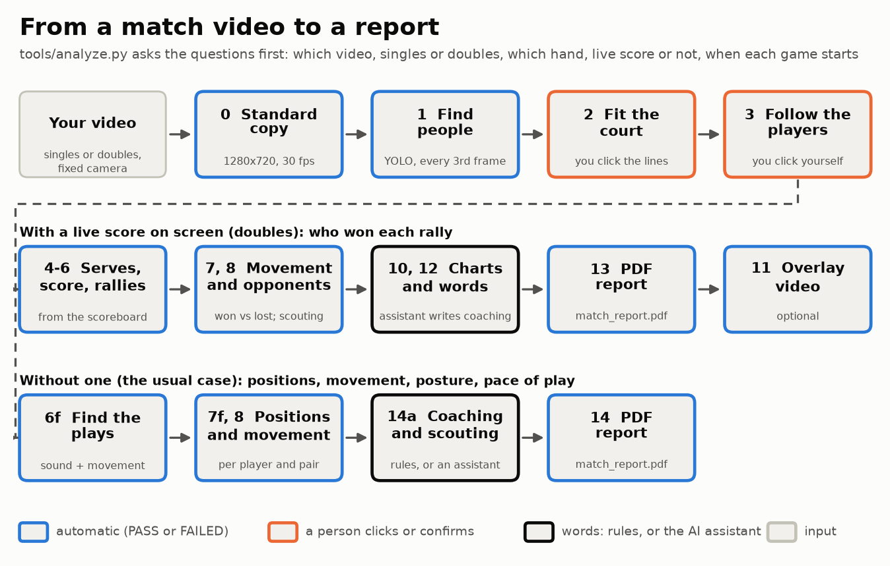

Blue steps run on their own and end with a PASS or FAILED check; orange steps need a person to click or confirm; black is where the words are written (by rules, or by an AI assistant from the numbers).

| stage | does | output |
|---|---|---|
| 0 | makes a standard 1280x720, 30 fps copy | `proxy.mp4` |
| 1 | finds every person (YOLO) | `dets.json` |
| 2 | fits the court to the picture from points you click | `calib.json` |
| 3 | you click yourself (partner and opponents found for you); follows the players in court metres | `players_config.json`, `players.npz` |
| 4a to 6 | scoreboard route: reads the score, works out who served and won, marks rallies | `points.json` |
| 6f, 7f | no score: finds the plays from movement and shuttle sound; positions, formation, movement per player and pair | `play_windows.json`, `free_stats.json` |
| 7, 7b | scoreboard route: distance, speed, where you stood, won against lost; the opponents | `motion.json`, `opponents.json` |
| 8 | body landmarks: knee bend, racket hand | `pose_stats.json` |
| 9 | looks for shuttle pickups (did not work on the reference video) | `pickups.json` |
| 10 to 13 | scoreboard route: text report, images, the PDF | `report.md`, `images/`, `match_report.pdf` |
| 14a, 14 | no score: coaching and scouting words by rules, then the PDF | `tips.json`, `scouting.json`, `match_report.pdf` |
| 11 | overlay video with a spoken summary (optional) | `analysis_video.mp4` |

Details and file formats: [docs/HOW_IT_WORKS.md](docs/HOW_IT_WORKS.md). How it was built, what went wrong and what was learned: [docs/PROJECT_REPORT.md](docs/PROJECT_REPORT.md). Version history: [CHANGELOG.md](CHANGELOG.md).

## Privacy and rights

* The analysis runs **on your computer**. Your video is never uploaded by this project.
* **If you use an AI assistant, frames it looks at are sent to that provider** as part of the chat. The assistant is told to ask you first; if that is a problem (children in the video, say), look at the check images yourself.
* Videos show real people. Only analyse video you filmed or have permission to use, and do not publish frames that show faces. `tools/anonymize.py` blurs faces for examples, but no automatic blur is guaranteed: look at every image.
* The PDF contains charts only. The pages where you click (court lines, yourself) run in your own browser.
* Nothing is downloaded unless you ask: the one exception is the optional `tools/fetch_video.py`, which saves a single YouTube video you filmed or may use.

## Licence and credits

[AGPL-3.0](LICENSE). The person detector and pose model are [Ultralytics YOLO](https://github.com/ultralytics/ultralytics) (AGPL-3.0); their weights download on first run and are not included. Court geometry follows the Badminton World
Federation laws of badminton. On macOS the optional scoreboard reader uses Apple's Vision framework.

## Contributing

Issues and pull requests are welcome, especially results on other videos, a way to enter the score of each rally by hand (which would give the no-score route winners), a Windows/Linux scoreboard reader, and singles on a real
video. See [CONTRIBUTING.md](CONTRIBUTING.md).
